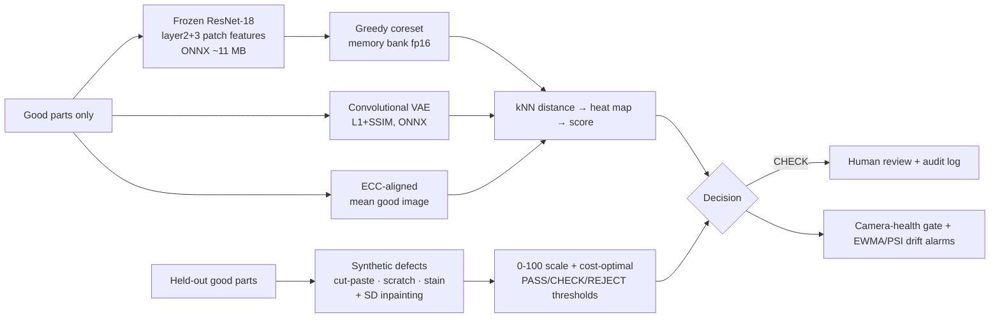

# 🔎 DefectSpotter — visual inspection without defect labels

**Project 3 · Manufacturing.** Factories rarely have many images of defects; most parts are good. DefectSpotter learns
**only from good parts**, flags anything unusual, **shows where** the anomaly is and turns it into a
**PASS / CHECK / REJECT** decision for the quality inspector at the end of the line — cutting both missed defects
(escapes) and false rejects.

* **Live app:** Gradio dashboard (`python app.py`) — deployable to a free Hugging Face ZeroGPU Space with one command.
* **Notebook:** [`DefectSpotter_End_to_End_Colab_HUGGINGFACE.ipynb`](DefectSpotter_End_to_End_Colab_HUGGINGFACE.ipynb) — EDA → training → evaluation → dashboard → deployment.
* **Data:** MVTec AD (bottle, screw, carpet; metal nut for few-shot onboarding) — CC BY-NC-SA 4.0, research/teaching only.

<!-- RESULTS:START -->
<!-- RESULTS:END -->

## What the app does

| Tab | What you can do |
|---|---|
| 📘 **Story** | The presentation: business problem, user, pipeline, methods, data, results, responsible AI, 2-minute demo guide |
| 🔍 **Inspect** | Choose a product, upload / paste / webcam a part (or click a held-out sample): anomaly score, decision card, heat map + suspected regions, **all four detectors side by side**, VAE reconstruction, interactive pixel map, camera-health check, ground truth for samples, JSON record; ~1 fps **live camera** mode |
| 📦 **Batch** | Inspect a tray/shift at once (or load a sample batch): decision tiles, score strip vs decision zones, summary table, overlay gallery, **CSV export** |
| 🧑‍🔧 **Review** | **Human-in-the-loop** queue of CHECK decisions: confirm defect / release as good with a note → **audit log** (CSV) |
| 🎚️ **Threshold & cost** | The **threshold slider trade-off** priced in money: false rejects vs escapes vs inspector load, score distributions, decision matrix, policy comparison, **apply the cost-optimal threshold computed without real defects** |
| 📊 **EDA** | Dataset composition, defect types, acquisition statistics, defect sizes and locations, montages, synthetic & diffusion defects |
| 🧠 **Models** | Image/pixel AUROC, AUPRO, AP with CIs, ROC curves, per-defect-type decisions, VAE vs PatchCore, qualitative panels, backbone study, latency, footprint, VAE training, HPO tables |
| 🌗 **Drift** | Simulate lighting / focus / camera changes on a real part; 200-part production stream with **EWMA + PSI alarms**; drift sensitivity heat maps; monitoring policy |
| 🆕 **New product** | **Few-shot onboarding**: build a detector for a new product (metal nut) from a handful of good images in seconds and inspect it |
| ⚙️ **API** | `/inspect_part`, `/inspect_batch`, `/health` + model card |

The global controls (product, detector, **threshold**, **CHECK band**) apply to every tab.

## How it works



1. **PatchCore-style detector (primary).** A frozen ImageNet ResNet-18 (`layer2` + `layer3`, 3×3 local averaging) turns
   every image into a 28×28 grid of 384-d patch descriptors. All good training patches form a memory bank compressed by
   **greedy k-center coreset selection** (keeps rare-but-normal patches that random sampling would drop). A test patch's
   distance to its nearest normal patch is its anomaly; the map is upsampled and smoothed, the image score is the max /
   top-k mean.
2. **Convolutional VAE (Generative AI).** Trained on good parts (L1 + SSIM + β·KL, 128-d latent). Reconstruction error
   (pixel + structural) is a second, independent detector, compared head-to-head with PatchCore.
3. **Classical baseline.** ECC alignment (translation / rigid / affine chosen on synthetic data) to a median good reference,
   then a per-pixel z-score against the mean and standard deviation of aligned good parts.
4. **Synthetic defects choose the threshold.** Procedural **cut-paste / scratch / stain** defects and
   **Stable-Diffusion inpainting** (SD-1.5 inpainting + LCM-LoRA, product-specific prompts, masked composite) on held-out
   good parts. Each synthetic defect is also replayed at **25% / 50% severity** (detection-limit calibration — real screw
   thread damage is far subtler than full-strength synthetic defects). With held-out good parts they set the score scale
   (25 = typical good, 75 = typical synthetic defect), tune hyper-parameters label-free and pick the **cost-optimal
   three-way thresholds**. Real defects are used only to measure how far that threshold is from an oracle chosen with labels.
5. **Decisions with economics.** `PASS < t − b ≤ CHECK < t + b ≤ REJECT`; `(t, b)` minimise
   `(1−p)·FRR·C_false_reject + p·escape·C_escape + review·C_check` with inspector capacity ≤ 10% of parts.
6. **Responsible operation.** No automatic decision on images outside the qualified acquisition range (brightness /
   contrast / focus z-scores) — they go to CHECK; EWMA control charts and PSI on the score stream and camera-health
   signals raise drift alarms; every CHECK is decided and logged by a human.

## What changed compared with the first notebook (critical review)

| Issue in the original notebook | Fix |
|---|---|
| "Coreset" was **random** subsampling | real greedy k-center coreset (PatchCore) — unit-tested to keep rare clusters |
| MobileNetV3-Small backbone (screw AUROC 0.77, carpet 0.78 in our study) | **backbone study** → ResNet-18 (screw 0.93) within the 10–20 MB ONNX budget |
| Never executed, no results; 109 KB base64 zip inside the notebook | full run with real numbers; notebook clones the repo and runs readable stages |
| Space needed PyTorch (+ FAISS) at runtime | **ONNX-only runtime** (extractor + VAE) — light, fast installs |
| Score scale anchored on combined quantiles; saturated heat maps | label-free anchors (good / synthetic medians) and a piecewise pixel scale |
| HPO objective could not separate configs (synthetic AUROC saturates at 1.0) | adds TPR at ≤1% false rejects, the operating requirement |
| PSI-only drift demo; health signals not used for decisions | camera-health **gate** + EWMA control charts + PSI; maintenance-aware stream |
| Diffusion defects disabled by default and never compared | SD inpainting generated (CPU-feasible with LCM-LoRA) and its threshold compared with real defects |
| Thresholds set by conspicuous synthetic defects only (first run: 35% screw escapes) | detection-limit calibration: synthetic defects replayed at 25/50/100% severity; v1 kept for comparison |
| No human review workflow | review queue + audit log; ground truth shown on samples |
| Dual-axis charts, dark hero | single-axis charts, colour-blind-validated palette, light theme |
| ZeroGPU claim without `@spaces.GPU` | ZeroGPU-compatible entry point; deployment script with clear free-tier rules |

## Run it locally

```bash
git clone https://github.com/hbasired/defectspotter.git && cd defectspotter
python -m venv .venv && source .venv/bin/activate      # Windows: .venv\Scripts\activate
pip install -r requirements.txt                         # runtime only - no PyTorch needed
python app.py                                           # → http://127.0.0.1:7860   (--share for a public link)
```

Trained models (`artifacts/`, ≈80 MB) and the evidence the dashboard plots (`reports/`, `examples/`) are in the repository,
so the app works immediately after cloning. Python 3.10–3.13.

### Reproduce the whole experiment

```bash
pip install -r requirements-train.txt
python scripts/download_data.py --dest data/mvtec_ad                 # pinned HF mirror of MVTec AD (1.3 GB)
python scripts/train.py --data data/mvtec_ad                         # ~1 h on a 4-core CPU, ~15 min on a GPU
pip install -r requirements-diffusion.txt                            # optional GenAI defects
python scripts/generate_diffusion_defects.py --data data/mvtec_ad
python scripts/train.py --data data/mvtec_ad --stages severity diffusion calibrate evaluate drift summary
python scripts/backbone_study.py --data data/mvtec_ad                # optional, ~25 min on CPU
pip install -r requirements-dev.txt && pytest                        # 26 tests
```

### Deploy (Hugging Face, free ZeroGPU tier)

```bash
export HF_TOKEN=hf_xxx                       # write token - never commit it
python scripts/deploy_hf.py --space bhkr0901/defectspotter
```

Free personal accounts (verified e-mail, account older than 30 days) can host up to two Gradio Spaces on ZeroGPU; CPU-basic
Gradio Spaces now need PRO. All inference runs on CPU with ONNX Runtime, so visitors never use GPU quota. Details:
[`DefectSpotter_HuggingFace_Deployment_Guide.md`](DefectSpotter_HuggingFace_Deployment_Guide.md).

### API

```python
from gradio_client import Client, handle_file
client = Client("http://127.0.0.1:7860")   # or "bhkr0901/defectspotter"
record, overlay = client.predict(handle_file("part.png"), "bottle", "patchcore", None, None, api_name="/inspect_part")
print(record["decision"], record["score"], record["regions"])
```

## Repository layout

```
app.py                      entry point (local, Colab, Hugging Face ZeroGPU)
defectspotter/              library: data, synthetic, features*, patchcore, vae*, baseline, metrics, decision,
                            drift, runtime (ONNX-only inference), pipeline*   (* = needs PyTorch, training only)
ui/                         Gradio app: theme, charts (Plotly), story (presentation), store (reports), app
scripts/                    download_data, train, generate_diffusion_defects, backbone_study, deploy_hf, summarize_results
artifacts/                  ONNX feature extractor + per-product memory bank, VAE (ONNX), baseline, calibration.json
reports/                    every metric/table/figure the app and README show (CSV/JSON/PNG)
examples/                   down-scaled MVTec test images (CC BY-NC-SA 4.0) for the demo
docs/                       model card, data card, screenshots
tests/                      unit + integration tests
```

## Responsible AI and limitations

* CHECK is a first-class outcome routed to a trained inspector; the audit log stores verdict, note, score, threshold and detector.
* The score is an anomaly **ranking**, not a defect probability; heat maps show visual deviation, not root cause.
* Lighting, focus and camera-position changes make good parts look anomalous — monitored with the camera-health gate,
  EWMA charts and PSI; alarms trigger maintenance and re-qualification, never silent retraining. Geometric camera shifts
  are **not** caught by brightness/sharpness signals (see the Drift tab) — the score chart is needed for those.
* Synthetic defects calibrate thresholds but do not prove coverage of every real failure mode.
* MVTec AD is non-commercial (CC BY-NC-SA 4.0). A production line needs plant-owned data, a qualified camera, lot/time-separated
  validation of every critical defect mode, access control and a documented response to CHECK, drift and camera failure.

See [`docs/MODEL_CARD.md`](docs/MODEL_CARD.md) and [`docs/DATA_CARD.md`](docs/DATA_CARD.md).

## Citation

Bergmann, Batzner, Fauser, Sattlegger, Steger. *The MVTec Anomaly Detection Dataset.* IJCV 2021 · Roth et al.
*Towards Total Recall in Industrial Anomaly Detection (PatchCore).* CVPR 2022 · Li et al. *CutPaste.* CVPR 2021 ·
Kingma & Welling. *Auto-Encoding Variational Bayes.* ICLR 2014 · Luo et al. *LCM-LoRA.* 2023.

Code: MIT (see `LICENSE`). Data and derived models: CC BY-NC-SA 4.0.
